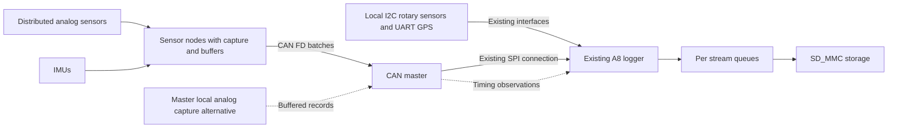

# A8 and CAN master mixed load architecture review

12 November 2026. Architecture assessment; component selection and workload acceptance remain open.

The strongest improvement is to separate **when a sensor is measured** from **when the ESP32 transports and writes its readings**. Follow the user's preferred order: firmware changes first, CAN-master changes second, logger hardware changes third. Firmware can improve the current envelope, but neither full analog target has a defensible service budget on the existing ADS1220 pair. Buffered acquisition on CAN nodes and on a revised master are alternatives that retain A8 hardware; node-side work is currently deferred at the user's request. Giving the CAN master its own SPI controller is a separate, worthwhile isolation option: SPI3 is unused in the inspected implementation, but the A8 v1.0 connector shares the ADC wiring, so physical rerouting is also needed. This bus split can be evaluated while retaining the existing ADCs.

Mixing buffered and unbuffered sources creates additional scheduling constraints: a system can have enough average throughput and still miss an unbuffered sensor's observation deadlines. Autonomous capture with a FIFO can remove those deadlines from the logger, although its finite capacity, the collector's own deadlines and every downstream throughput limit remain. A faster or simultaneous ADC alone does not provide that separation.

## Concept summary and assumptions

The objective is useful mixed acquisition with trustworthy identity, sample association, timing evidence and explicit quality limitations. The user specified an aggressive target of either eight analog sensors at 500 Hz or four at 1 kHz, plus a UART GPS at 25 Hz and two I2C rotary sensors at 500 Hz each. Cross-sensor alignment within one or two periods of each local sensor's target acquisition rate is sufficient. The eventual four nominal 3333 Hz IMUs remain the remote design goal; one real IMU remains the demonstrated configuration.

GPS hardware is unidentified: 25 Hz is a receiver-selection requirement, not a claim about an installed DAN-F10N. Standard AS5600 is the representative rotary sensor; budget its fixed addressing and short register reads rather than assuming programmable addresses.

This review considers firmware improvements, a revised A8/master, and a separate local collector. It does not select a replacement PCB or change existing admission rules. The earlier decision to retain the boards applied to the drain redesign round; the current request explicitly reopens hardware alternatives. Existing recordings must remain readable. No new ADR is appropriate until an architectural choice is accepted.

Node-side analog implementation/prototyping is on hold. Its assessment remains below as an option; current review work additionally evaluates a dedicated logger-to-master SPI bus. No node work, device test or hardware change follows from retaining that comparison.

## Assessment against the specified workload

| Source | Acquisition target | Interpretation of one or two sample periods for alignment | Current constraint |
|---|---|---|---|
| Analog profile A | 8 x 500 Hz | Approximately 2–4 ms | Four channels per ADS1220 require 2000 conversions/s per chip before host overhead |
| Analog profile B | 4 x 1000 Hz | Approximately 1–2 ms | Even the best balanced layout requires 2000 conversions/s per chip; current single-shot scan cannot supply it |
| Rotary | 2 x 500 Hz, AS5600 representative | Approximately 2–4 ms | Short-read scheduling appears plausible; two standard AS5600s need address isolation on the existing A8 |
| GPS | 25 Hz, receiver to be selected | Approximately 40–80 ms | Select a receiver supporting 25 Hz in the intended navigation mode and adapt the current 10-Hz-capped driver |

These are alignment interpretations, not newly agreed limits on every inter-acquisition gap or acquisition-to-RAM delivery time. Timely timestamp evidence can preserve alignment through delayed batch delivery. Conversely, accurately timestamped reads do not establish physical alignment if device/filter delay is unknown. Signal bandwidth, analog precision and allowable gap/reuse frequency remain open.

Both analog profiles require 4000 distinct readings/s overall. The existing pair's combined 4000-SPS headline leaves no scheduling margin even before real conversion/start/read costs. The measured 0.95 ms per conversion at the fastest setting is about half the required aggregate throughput per active chip. A firmware-only round should establish a useful lower envelope and eliminate avoidable work; it should not attempt to manufacture a full-target pass by duplicating cached values. Looser alignment does not create missing conversions. [ADS1220 timing and rate specification](https://www.ti.com/lit/ds/symlink/ads1220.pdf).

The target is modest in raw local payload: with 16-bit analog storage, either profile produces 8 kB/s; two 16-bit rotary channels add 2 kB/s. Per-reading timestamps/headers and GPS fields can substantially increase that amount. If acquisition moves onto the master, this added traffic joins CAN batches on the master-to-logger link. Its raw size alone cannot establish available margin against the roughly 160 kB/s four-IMU raw floor; qualify the combined framed workload and pack records efficiently.

### Rotary acquisition before additional hardware

For an ordinary two-byte register read with an address-pointer write, count approximately 45 I2C clock pulses: address/write, register, address/read and two data bytes including acknowledgment bits. At 400 kHz this is 112.5 us before start/stop timing, diagnostics, software and contention. Two 500 Hz sensors on one bus therefore consume roughly 11.25% of wire time for those basic reads, or 5.625% per bus if split. This is a lower-bound calculation, not achieved firmware timing. It is much less demanding than the earlier multiple-IMU FIFO experiments, so those failures do not establish that these two rotary sensors require offloading.

For the representative AS5600, address isolation is a concrete requirement: the A8 fuel gauge occupies bus0 address 0x36, also the fixed AS5600 address. Two ordinary AS5600s cannot simply be assigned one to each existing bus, and two at the same address cannot coexist directly on bus1. `SensorAssignment.cpp` already reserves the fuel-gauge address. Disabling fuel-gauge polling does not electrically remove its response. See the [AS5600 datasheet](https://www.infineon.com/assets/row/public/documents/30/49/infineon-as5600-datasheet-en.pdf).

The first option for preserving A8 hardware is an external I2C switch/mux on bus1, with one AS5600 on each of two downstream branches. A TCA9548A illustrates this arrangement: it resolves duplicate addresses through selectable branches and supports 400 kHz. Select exactly one AS5600 branch at a time. An illustrative branch-select write adds 18 clock pulses, or 45 us at 400 kHz; selecting before every 45-clock sensor read raises the pair's basic wire demand from 11.25% to about 15.75%, before other overhead. This remains plausible for a dedicated bus but requires physical qualification. [TI TCA9548A datasheet](https://www.ti.com/lit/ds/symlink/tca9548a.pdf).

Mux support is a firmware change as well as an adapter: include branch identity in configuration, duplicate-address validation and recorded sensor identity, and hold the bus lock across selection and the associated read. Serialize diagnostics through the same selection path. Define recovery for a selected branch holding the bus low; an I2C deselect command cannot be relied on while the bus is stuck. The adapter's reset/power arrangement or an explicitly manual recovery policy needs consideration. This topology retains the A8 PCB and leaves bus0's fuel gauge, RTC and display separate.

If avoiding any external mux is more valuable than retaining standard AS5600s, address-configurable rotary variants are an alternative. The [AS5600L](https://www.infineon.com/part/AS5600L) is one example, but it is a different part and requires driver/electrical verification. Master-side separate buses remain another option if a master revision is already justified for analog acquisition.

Start with the rotary drivers' existing independent 500 Hz acquisition setting, short angle reads, bounded diagnostics and preserved failure/reuse status. Avoid mandatory diagnostic register reads on every observation. Verify actual sensor filtering and observation intervals under concurrent CAN/ADC/storage work. Keep the GPS and rotary sensors on their present interfaces unless those measurements or addressing demand otherwise; a revised analog collector need not absorb every local sensor.

### GPS capability and UART budget

Select the unidentified GPS receiver for 25 Hz navigation in the intended constellation and positioning mode, including solution timestamps, output messages and an electrically compatible UART. Then adapt the driver and configuration to its verified capability. Active `DANF10NGpsSensor.cpp` currently limits rates to 1/2/5/10 Hz and polls its parser every 20 ms; this is not yet a generic 25 Hz receiver interface. DAN-F10N is a reference for existing code, not the selected receiver: its R04 datasheet specifies 10 Hz in the listed multi-constellation configurations and 20 Hz in single-GNSS mode. [u-blox DAN-F10N datasheet, Tables 2 and 3](https://content.u-blox.com/sites/default/files/documents/DAN-F10N_DataSheet_UBXDOC-963802114-13074.pdf).

Illustratively, one 100-byte binary navigation message at 25 Hz needs 2500 bytes/s, or 25 kbit/s on an 8N1 UART. This uses about 65% of 38400 baud and takes about 26 ms to serialize each message; at 115200 baud those values are about 22% and 8.7 ms. Actual message selection, bursts and receiver support determine the configuration. Disable unnecessary output, retain each required navigation epoch rather than just the newest parser snapshot, and use receiver solution time with a verified logger-clock association. UART receipt time alone includes serialization and receiver processing delay. Millisecond-scale timing evidence should be evaluated before requiring a new PPS/SYNC wire or sub-microsecond hardware alignment.

## Evidence and source identity

The starting point is the [hardware handoff](../../../BODAQS-worktrees/drain-capacity-evidence/first-real-imu-implementation/adc-four-channel-scaling-preparation/HARDWARE_REVIEW_HANDOFF.md), cross-checked against the [r14 C report](../../../BODAQS-worktrees/drain-capacity-evidence/first-real-imu-implementation/adc-channel-rate-r14-C-700-report/ASSESSMENT.md), [D2 report](../../../BODAQS-worktrees/drain-capacity-evidence/first-real-imu-implementation/adc-channel-rate-r14-D2-report/ASSESSMENT.md), [sustained r13 report](../../../BODAQS-worktrees/drain-capacity-evidence/first-real-imu-implementation/storage-worker-priority-r13-sustained-bb41415f9927-report/ASSESSMENT.md), and [four-channel preparation](../../../BODAQS-worktrees/drain-capacity-evidence/first-real-imu-implementation/adc-four-channel-scaling-preparation/OPERATOR.md).

Firmware references below mean the active integration worktree, `C:/Users/benco/dev/BODAQS-worktrees/imu-first-recording-design`, commit `d7e286d53f987444131738ec0ef6c9b2e9d258cf`. The canonical checkout where this review is saved is older (`b8407363a4b07e114e4b39dfd95fd5073a1c64c9`). Its bootstrap protocol documentation is not the current recording protocol. Active `common/protocol/bodaqs_measurement.h` and the r14 environment select 256-byte measurement transactions at requested 16 MHz; the board profile's 4 MHz master default describes a different path.

| Observation | Architectural implication | Limit of the evidence |
|---|---|---|
| One real IMU plus one analog channel per ADC at 500 rows/s sustained about 9.8 minutes, with about 0.373% reuse | The present partition can support a useful mixed workload | One missing IMU terminal sample; floating analog inputs; not general qualification |
| Two channels on one ADC at 700.28 rows/s reused about 29% of readings | Row cadence exceeds the represented fresh information rate | About 499–500 fresh row uses/s/channel; this is not every physical conversion |
| D2 ADC loop mean about 950 us, setup/read means about 153/161 us | Converter time and host service both matter | These elapsed measurements include dispatch and contention, not exclusive CPU or wire time |
| D2 maximum cache age 39.665 ms despite zero timeouts and zero row flags | A valid row and healthy mean do not establish recent measurements | Aggregates cannot locate or explain the excursion |
| Increasing ADC priority alone coincided with storage queues filling; raising storage priority restored balance | Capacity is an end-to-end scheduling problem | Card/run variability and direct CPU causality were not isolated |
| Synthetic ACK/fetch reached 223.773 kB/s | Batching and ownership changes materially improved useful transport | Excluded native CAN service and SD recording; not four-IMU capacity |
| Four local analog channels are prepared but not run | The second busy ADC's added demand remains a useful discriminator | r14 excludes that mixed case; offline configuration validation is not acquisition evidence |

Retain the handoff's distinctions between sample loss, request drops, replay, repeated analog readings and incomplete STOP tails. The notes support an architecture review well; their most important unresolved issues are physical analog validity, the long age excursion, source-tail accounting and startup clock lifecycle. None currently identifies a proven PCB electrical defect.

## Existing hardware and firmware constraints

### The shared SPI path

The A8 v1.0 schematic exports both ADS1220s and the master connection onto the same SCK/PICO/POCI nets. Active `BoardProfile.cpp` selects GPIO37/38/39, ADC chip selects GPIO47/21, master select GPIO40, and ADC DRDY GPIO36/18. SD_MMC has its own four-bit connection. The SPI bus is therefore serialized even though two ADC conversions can overlap and the ESP32 has two CPU cores.

The A8 J1 connector has six pins: ground, 3.3 V, CS, POCI, PICO and SCK. The live master J1 has eight pins, additionally providing `A8_IRQ` and VSYS. The nominal A8 connector provides neither ready IRQ nor a direct master SYNC input. The actual adapter/harness and any modifications remain as-built questions. The master front/rear connectors share one CAN bus and one logical SYNC source; they are not independent CAN capacity.

Active `SharedSpiBus.cpp` correctly releases its mutex during master-specific minimum-start spacing. That 500 us setting is per master CS, not an ADC sampling limit. It retains ownership during a transaction, including preparation, CS setup and HAL transfer. Task priorities cannot interrupt an already selected transfer.

`SharedSpiBus` calls Arduino `SPI.transferBytes`. The locally installed 2.0.17-generation HAL, corroborated by [Espressif's tagged source](https://github.com/espressif/arduino-esp32/blob/2.0.17/cores/esp32/esp32-hal-spi.c), services transfers through polling and up-to-64-byte FIFO chunks. This is a concrete driver optimization opportunity, rather than evidence that the current logger already DMA-buffers acquisition. A proposed ESP-IDF DMA adapter must be compared with the exact candidate framework and master timing; DMA is not automatically faster for tiny ADC commands.

### Giving the CAN master a dedicated SPI bus

**The spare controller exists.** ESP32-S3 has two general-purpose controllers, SPI2 and SPI3; SPI0/1 serve memory. In the inspected Arduino framework the global `SPI` object selects `FSPI`, which maps to SPI2 on S3. `SharedSpiBus.cpp` uses that object for both ADCs and the master. No second `SPIClass`, SPI3 host or independent ESP-IDF SPI initialization was found in active firmware. SD_MMC is separate, so storage does not consume SPI3. Arduino's `HSPI` identifier maps to SPI3 on this target; these software names should not be confused with the memory bus. [Espressif SPI guide](https://docs.espressif.com/projects/esp-idf/en/v4.4.7/esp32s3/api-reference/peripherals/spi_master.html), [Arduino SPI source](https://github.com/espressif/arduino-esp32/blob/2.0.17/libraries/SPI/src/SPI.cpp), [S3 HAL definitions](https://github.com/espressif/arduino-esp32/blob/2.0.17/cores/esp32/esp32-hal-spi.h).

One controller can therefore retain the two ADS1220s while the other drives the CAN master. They need electrically separate clock/data connections. Creating two software objects on the existing shared wires does not provide parallel bus access. A distinct chip select alone does not separate the existing SCK/PICO/POCI nets.

| Effect of the bus split | Assessment |
|---|---|
| Master transfers blocking ADC setup/read | Removed as direct wire/bus-lock contention when controllers have independent ownership |
| ADC traffic delaying useful master drain | Removed at the bus level; CPU/interrupt delays remain |
| ADC mode-1/1-MHz and master mode-0/16-MHz settings | Can remain independently configured on their respective controllers |
| ADC0 versus ADC1 service | Still shares the ADC bus, although conversions can overlap |
| ADS1220 conversion capacity and host-driven scan | Unchanged; neither complete aggressive analog profile follows from the split |
| Master turnaround, priming, minimum-start spacing and CAN ingress | Still need their own measured service budget; bus isolation is not permission to remove pacing |
| SD queues, CPU, memory and interrupt contention | Still shared; two buses do not imply twice the useful system throughput |

The current 256-byte master transfer takes at least 128 us at an actual 16 MHz before software and CS overhead. A separate bus removes that transfer's direct exclusion of ADC transactions and makes larger or DMA-driven master batches easier to consider without imposing the same ADC wire-blocking interval. Improved ADC freshness and master useful service are plausible outcomes, not measured gains. The existing ADC means do not identify how much time is removable bus wait versus converter or CPU delay. Polling both controllers from one execution context could still serialize them in software; independent controller ownership and suitable task/interrupt or DMA behavior are part of the evaluation.

**The A8 v1.0 wiring is the constraint.** J1's clock/data pins already connect to GPIO37/38/39 and the ADC networks. The schematic leaves module GPIO3, GPIO26, GPIO45, GPIO46 and GPIO48 unconnected, but they are not a ready-made second SPI connector. GPIO26 is unavailable on the N4R2 module because it serves embedded PSRAM; GPIO3/45/46 have boot-strapping roles. GPIO48 is another candidate. This is enough to justify a pin/routing study, not an approved pin assignment or a soldering instruction. Check reset-time loading, allowed signal directions, module variant and physical pad access before selecting routes. [ESP32-S3-MINI module datasheet, pin definitions and boot configurations](https://documentation.espressif.com/esp32-s3-mini-1_mini-1u_datasheet_en.pdf).

A future A8 revision could reroute only the master's connector clock/data lines to suitable spare pins, retaining GPIO40 chip select and the connector's external signal order if feasible. Its ADCs and master PCB could remain unchanged. This is a relatively contained logger revision, distinct from replacing the ADC/front end. Existing A8 boards would need a deliberately engineered rework/adapter or would retain shared-bus operation; a master-only PCB change cannot create the missing independent ESP32 signal connections. Repurposing existing exposed UART/I2C/UI pins is another possible bench arrangement, but it sacrifices functions and is not a transparent upgrade for the specified GPS/two-rotary workload.

**Firmware also needs an explicit bus interface.** `BoardProfile` currently contains one `SPIProfile`; `SharedSpiBus` has one global controller/mutex/configuration. The master code explicitly rejects nonzero `spi_bus_index` in several startup/measurement/recovery paths. Changing that field to 1 alone will not work. A split-bus candidate needs controller/pin profiles, independent bus locks/state, and consistent master transfers across bootstrap, recording and recovery, while ADC transfers retain their own bus. Keep the existing shared profile working for deployed boards. DMA remains an optional, separately measured change rather than a prerequisite for proving that wire contention has been removed.

For the review, this option deserves its own comparison with the existing ADCs and unchanged requested sensor settings. Measure actual simultaneous bus activity, master accepted bytes, ADC freshness/gap/age distributions, CPU/storage service and integrity. It may economically improve mixed operation below the ADC conversion ceiling. A replacement ADC or distributed acquisition remains necessary if the full 4000-distinct-readings/s analog target must qualify with useful margin.

### The ADS1220 conversion engines

Each chip has one multiplexed converter. Firmware restores all registers, explicitly starts a single-shot conversion, waits outside the SPI lock, reads the result, then starts another channel. It already uses DRDY interrupts in the asynchronous path. Merely proposing DRDY interrupts would duplicate an existing mechanism. Removing START already failed physically; preserve that finding.

At the nominal internal clock, the 2000-SPS turbo single-shot conversion occupies about 520 us, before up to 25 us oscillator wake time and host commands. Four channels at 500 independent readings/s would require a new result every 500 us on each chip: the conversion timing already leaves no usable margin. The current ten command/result bytes also require 80 us of wire time at 1 MHz. These are distinct from elapsed measured service times. See [TI ADS1220 conversion timing](https://www.ti.com/lit/ds/symlink/ads1220.pdf), Sections 8.3.7 and 8.4.

The current two-channel mean of 0.95 ms/conversion implies about 526 visits/s/channel if that mean persisted with perfect alternating service. That is only low-tens-per-second headroom over 500, and represented fresh row uses were lower. It establishes neither a worst-case bound nor an eight-channel benchmark. A faster SPI driver cannot turn two 2-kSPS mux converters into eight 1-kSPS independent channels.

Full-register restoration protects against an ADC reset unnoticed by a software register cache. Continuous conversion for a single fixed channel, a faster qualified ADC SPI clock, or a revised configuration-verification strategy might reduce costs. Each changes a recovery or timing assumption; none should be treated as an already validated command shortcut.

### The analog signal path

The schematic uses a TPS7A2030 3.0 V rail, switched/filtered analog excitation, and the same `3V0_EXC_A` net for the ADC analog supplies and positive external references. This is a useful ratiometric arrangement for compatible resistive sensors. Digital supply is 3.3 V. Connector symbol pin text saying 3.3 V is not evidence that the analog excitation is 3.3 V.

Each input has 100 ohms in series and 10 nF to ground. The isolated RC pole is approximately 159 kHz; it cannot by itself be credited with adequate rejection around a 250 Hz or 500 Hz Nyquist band. Sensor response, source impedance and converter filtering also contribute. Known-input switching, settling, noise and frequency-response checks are necessary before selecting rates or a replacement front end.

Active `scaleRaw24ToEffectiveBits_` clamps negative codes and reduces positive ADS results to the board profile's 12-bit output scale. A nominal 24-bit ADC replacement would not improve retained resolution unless this interface changes. Conversely, 16- or 18-bit simultaneous acquisition may be ample if the actual precision requirement is modest. Resolution, noise, bandwidth and channel timing are separate requirements.

### Master memory and timing ownership

The active worktree's master linker map, linked 11 November, reports 887 bytes unallocated in SRAM BANK0 with 4 KiB reserved stack, but 63,728 bytes unallocated in BANK1. This updates the handoff's older synthetic-map warning: there is bank-placement pressure, not evidence that all MCU RAM is exhausted. The map is a build artifact, not a device readback or measured stack high-water mark.

BANK1 allocation may provide economical buffering before replacing the MSPM0. Check DMA accessibility, ownership and reset behavior. The generated linker comment warns about modes deeper than SLEEP, but the current device datasheet specifies BANK1 retention through STOP; reconcile the selected silicon, SDK and actual power mode rather than treating the generated comment as the device specification. More request slots are especially unattractive without a residence-time argument: reducing the physical request queue already improved useful behavior. [TI MSPM0G3518 datasheet](https://www.ti.com/lit/gpn/MSPM0G3518).

The master startup fix and remaining rejected replies show why a ready signal must describe coherent, already primed reply state. IRQ can reduce empty polling and discovery delay; it does not replace retained identities, CRC, bounded retry or periodic recovery probing. Wire-data readiness and the availability of application work are different conditions.

## Why buffering changes the scheduling problem

An unbuffered I2C register sensor must be read near the observation times the analysis needs. A late read sees the later register contents; the missing history cannot be retrieved. A host-triggered ADC similarly postpones the measurement if its start is delayed. The single-shot ADS1220 holds a completed result, so a delayed read need not immediately destroy it, but it also delays the next conversion. These are different constraints from draining a free-running sensor FIFO before it fills.

With mixed sources on one bus, increasing batch size improves transport efficiency but increases the longest uninterrupted exclusion of a latency-sensitive source. Keeping every transaction short increases setup work and can reduce the capacity available to all sources. Even a low average utilization can be unschedulable when one legal long transaction exceeds another source's deadline.

This is established real-time scheduling territory. [Jeffay, Stanat and Martel](https://www.cs.unc.edu/~jeffay/papers/RTSS-91.pdf) analyze nonpreemptive periodic/sporadic service and require interval-demand conditions beyond utilization. Their assumptions do not directly cover BODAQS's whole RTOS, conversion waits and dependent queues. The applicable lesson is to bound indivisible service and check deadline windows; adopting EDF alone is not a proof.

Local project evidence reaches the same conclusion: the [October I2C experiments](../../../BODAQS-worktrees/imu-first-recording-design/docs/firmware/I2C_Scheduling_Experiment_Summary_2026-10-10.md) could not establish the desired unbuffered AS5600 cadence alongside four FIFO IMUs. Smaller drains slightly improved average AS5600 rate but increased overhead and degraded IMU timing observations. This is a reason to reconsider physical acquisition partitioning before adding another elaborate scheduler.

| Buffer location | What it protects | What it cannot protect |
|---|---|---|
| ESP32 queue after today's ADC/I2C read | Acquired history against delayed formatting or storage | Measurement times missed before that queue |
| UART RX FIFO and driver ring | Incoming bytes while the parser waits | FIFO overflow while interrupts are delayed; receiver/source timing ambiguity |
| ADC sequencer plus hardware FIFO | Acquisition while ESP32 services other devices | Converter/mux capacity, analog settling, FIFO overflow |
| Dedicated ADC bus plus verified DMA capture | Result transfer with reduced CPU involvement and no CAN wire blocking | Unbounded ISR/descriptor starvation or inadequate pre-DMA result storage |
| Local MCU with timer-driven capture and RAM | Batches local sensors independently of ESP32 work | Its own bus/capture deadlines and aggregate downstream deficit |

Thus mixing buffered and unbuffered sources imposes genuine additional limits on a fixed shared-resource design. They are not an unavoidable property of CAN plus analog sensing. Moving capture before the contested resource can eliminate that particular host scheduling constraint. It trades tight per-reading deadlines for longer FIFO-service deadlines and buffering latency.

For register-only I2C sensors, the collector must still poll deterministically. A proxy FIFO cannot reconstruct sensor-internal update times without relevant device evidence. For UART, the existing GNSS driver already configures a receive ring and maintains a latest snapshot; decide whether every navigation update or only current status needs retaining before redesigning it. The A8 exposes TX/RX without RTS/CTS on J5, so hardware flow control is not presently available through that connector. [Espressif's versioned UART guide](https://docs.espressif.com/projects/esp-idf/en/v5.2/esp32s3/api-reference/peripherals/uart.html) documents the separate receive-buffer and FIFO failure conditions.

## An end to end service budget

Model CPU execution, shared bus ownership, converter occupancy and storage service separately. Summing elapsed setup/read means as CPU utilization would double-count waiting; using wire time alone would omit real exclusion and dispatch costs. For each source specify acquisition rate and bandwidth, maximum observation gap, maximum age/latency, arrival bursts, capture-time semantics, queue capacity and overflow behavior.

For each stage with arrival envelope `alpha(t) = b + r*t` and guaranteed service `beta(t) = R*max(0,t-L)`, network calculus gives backlog at most `b + r*L` when `R >= r`; ordered FIFO delay is bounded by `L + b/R`. Positive excess service is needed to recover from a backlog. These claims require envelopes valid across all relevant intervals, not benchmark averages. See [Le Boudec and Thiran](https://leboudec.github.io/netcal/latex/netCalBook.pdf), Sections 1.2–1.4, and the [companion research note](Mixed_Load_Acquisition_Primary_Research.md).

Four 3333 Hz six-axis int16 sources produce 159,984 raw bytes/s. A 100 ms blackout accumulates roughly 16 kB of raw readings; 2.6 s accumulates roughly 416 kB, before framing, timing and record overhead. Which buffer needs that space depends on where service stops and how backpressure propagates. It is not valid to sum all queue capacities or infer four-node SD tolerance from one-node peaks.

The 223.773 kB/s synthetic object rate is neither a guaranteed service curve nor the denominator for raw-payload utilization. The current acquisition link has a distinct profile from bootstrap; CAN-FD's actual frame geometry, two bit-rate phases, arbitration, retries and timing/control load need their own budget. [Davis and colleagues' corrected CAN response-time work](https://link.springer.com/article/10.1007/s11241-007-9012-7) is relevant precedent, but its classical-CAN model must be adapted rather than applied unchanged to CAN-FD and the later SPI stages.

A suitable scheduler gives every participant bounded useful service, reserves control/timing work against actual deadlines, and chooses bounded eligible transfers at transaction boundaries. FIFO occupancy increases urgency. Empty polls, retries and failed-device recovery require caps so one endpoint cannot consume all service. Storage needs a protected service budget too. General loss/reuse thresholds remain a product decision, not a new universal 70% or 85% rule.

## ADC alternatives

Select an acquisition architecture before selecting a part. The important independent choices are simultaneous versus multiplexed conversion, host-driven versus autonomous timing, depth of result storage, input/reference compatibility, and useful bandwidth. A mux ADC with a good sequencer/FIFO may suit slow mixed sensors better than a fast simultaneous ADC with almost no buffering.

| Candidate class | Benefit | Cost or limitation for A8 |
|---|---|---|
| Existing ADS1220 pair | Smallest change; preserves ratiometry and existing recovery logic | One conversion engine per four inputs; limited aggregate cadence; host services every conversion |
| [ADS131M08](https://www.ti.com/lit/ds/symlink/ads131m08.pdf), eight simultaneous delta-sigma channels | Removes mux skew; up to 32 kSPS/channel; predictable frames | Only two results buffered/channel; input/reference span differs from 0–3 V A8; common hardware rate and filter delay |
| [ADS131E08](https://www.ti.com/lit/ds/symlink/ads131e08.pdf), simultaneous precision acquisition | Eight converters; up to 64 kSPS | 24-bit output only through 16 kSPS, 16-bit at 32/64 kSPS; front-end, power and result-read deadlines still matter |
| [ADS8588S](https://www.ti.com/lit/ds/symlink/ads8588s.pdf) or [ADS8598H](https://www.ti.com/lit/ds/symlink/ads8598h.pdf), simultaneous SAR | Hardware trigger, no mux sharing; 16-bit/200-kSPS or 18-bit/500-kSPS capability | Bipolar industrial input ranges, 5 V analog supply and larger interface/power budget; operate much slower if appropriate |
| [AD4130-8](https://www.analog.com/media/en/technical-documentation/data-sheets/ad4130-8.pdf), autonomous mux and FIFO | Sequencing plus 256 conversion results of actual on-chip buffering | One converter; 2.4-kSPS headline is not settled scan throughput; switching and digital-filter settling must be budgeted |

The shortlist illustrates trade-offs, not equivalent parts or purchase recommendations. The [research note](Mixed_Load_Acquisition_Primary_Research.md#adc-architecture-shortlist) provides datasheet sections and more detail. Ratiometry, grounded sensor input range, reference loading, anti-alias response, noise at the selected rate and power must be checked for every candidate.

One useful warning: at an actual 16 MHz, a 256-byte master transaction takes at least 128 us on the wire. An ADC with two results/channel at 32 kSPS has at most about 62.5 us of idealized empty-buffer history, and available headroom depends on phase and occupancy. Putting it on the same bus can make loss-free capture harder, despite much higher converter throughput. Simultaneity is valuable, but capture storage and a viable transfer schedule are essential.

Simultaneous channels improve relative phase measurements within that ADC. They do not align local readings with remote IMUs automatically. Clock correlation, trigger distribution, oscillator drift and converter/filter delays still determine cross-sensor alignment. Delta-sigma results integrate over a filtering interval; their DRDY edge is not an instantaneous input sample time. A SAR's trigger gives a clearer aperture reference, with its analog and optional digital filtering still to characterize.

## Different local acquisition and row rates

Allow independent local rates. The current global row rate is a presentation/storage coupling that unnecessarily makes slow channels follow the fastest primary cadence. Specify separately the desired and effective acquisition rates, rate of distinct retained readings, and any display/export row rate.

For the current mux ADCs, a weighted scan could prioritize a fast suspension channel and visit a slow auxiliary channel less often. It can save actual converter and bus work if acquisition visits decrease. Qualification must include longest gaps and channel-switch settling, rather than average rate alone. Lowering only the row rate while workers continue scanning does not provide the same saving.

For a simultaneous ADC with a common hardware cadence, acquire the enabled bank at one qualified rate and derive slower outputs per channel. Lower output rates reduce storage and downstream processing; they may not reduce ADC frame traffic. Use appropriate filtering before decimation and retain its delay/phase metadata. Taking every Nth reading or repeating a cached value is not an adequate anti-alias filter. [Analog Devices sampling tutorial](https://www.analog.com/media/en/training-seminars/tutorials/MT-002.pdf).

Prefer sequence-addressable local native streams, or a common native frame for a simultaneous group, with acquisition timing/evidence and explicit gaps. A rectangular export can be generated afterward. A latest-value cache remains useful for UI and legacy row views if it carries source sequence, source time, age and repeat/invalid status. Complete history and minimum display age are different objectives; the [research note's freshness discussion](Mixed_Load_Acquisition_Primary_Research.md#freshness-and-complete-history-are-different-objectives) explains why status-update queue replacement results do not justify discarding measurement history.

Current ADC age starts when `publishCachedSample_` publishes the completed read. It excludes the preceding conversion/filter interval and any result waiting before publication. Independent records must improve those timing semantics, rather than relabeling publication or row time as physical acquisition time. Aggregate freshness counters alone do not preserve per-reading timing and repeat identity in recorded rows.

## Analog acquisition on CAN nodes

There can be a disproportionate architectural and product benefit from node-side analog acquisition, particularly when sensors are distributed around the bicycle and the logger has an installed user base. The benefit comes from autonomous capture, useful batching and a stable logger-facing interface. CAN itself does not create extra capacity or make buffering unnecessary. A buffered master-side ADC can deliver the same fundamental reduction in logger capture deadlines while avoiding the CAN hop.

### Existing design fit and implementation gap

The [sensor network design](../../../BODAQS-worktrees/imu-first-recording-design/docs/firmware/CAN-FD_Sensor_Network_Design.md) already provides two analog inputs and two independent I2C ports on each full node. A fresh netlist export of the live `CANBUS_IMU.kicad_sch` confirms AIN1 on PA14/ADC0_12 and AIN2 on PA17/ADC1_2. The MSPM0G3507 has dual 12-bit ADCs and timer/DMA capability, making bounded local capture at these rates a credible candidate. This establishes hardware capability to investigate, not analog accuracy or a verified simultaneous pin/trigger configuration. [TI G3507 datasheet](https://www.ti.com/lit/ds/symlink/mspm0g3507.pdf).

Four full nodes with two 500 Hz analog inputs each match the eight-channel target. Two analog inputs at 1 kHz on each of two of those nodes match the four-channel target, leaving the other nodes available for their IMU duties. Full-node designs are distinct from the currently demonstrated IMU-only node: analog connections are not present merely because the same MCU family has ADCs.

The active `node/src/main.c` identifies its hardware as IMU-only and advertises only endpoint 0. `bodaqs_master_service_receive_can_ordered` accepts the existing IMU identifier in its sample lane; it is not a generic forwarder for every reserved endpoint. Node acquisition/control, master acceptance and buffering, logger dispatch/configuration, and BDQ/analysis schemas need explicit analog support. Existing analog endpoint numbers are useful design groundwork, not implemented recording support.

There are also only four node addresses: two physical straps, `BODAQS_CAN_NODE_COUNT=4`, fixed identifier allocation, and four-entry participant/retention structures. Reusing two analog ports on the four IMU nodes fits that envelope. Adding separate analog-only nodes alongside four IMU-only nodes does not; that would require addressing, protocol, configuration and memory changes. An analog-only node variant can still be useful where the total node count remains within the supported envelope.

### Scheduling benefit and its limit

A timer/DMA acquisition path can capture analog readings into a bounded node queue independently of CAN arbitration and ESP32 activity. The logger no longer needs to send a setup/start transaction and a read transaction for every conversion. If A8 analog acquisition is disabled, its shared measurement SPI no longer has ADC service competing with master transfers during the recording. The logger instead handles buffered source records, much as it does for remote IMUs.

This separates the ADC conversion cadence from the master-poll cadence and allows more efficient bulk transport. It also keeps analog acquisition work off the CAN master's main execution path, which may be preferable to adding another capture duty to the gateway. Conversely, adding ADC DMA, interrupts and CAN publication to an IMU node introduces interference there; IMU FIFO servicing, timestamp evidence and control still need protected service. Local buffering must cover the admitted CAN-service gaps, and CAN TX queues must not be allowed to delay control indefinitely.

The gain is primarily schedulability and lower software/transaction overhead, not a guaranteed increase in total useful throughput. Node analog samples now cross CAN as well as master SPI and SD. Master-local buffered capture avoids that extra CAN demand. All paths still share logger RAM, CPU and storage capacity.

### Batching determines the added transport cost

Both analog profiles generate 4000 readings/s, or 8 kB/s at 16 bits per reading. That is 5% of the four-IMU raw six-axis payload floor, but it is not a 5% utilization increment: CAN frames, timing, control and bridge records add costs.

For an illustration, give each of four nodes two channels at 500 Hz. Pack eight paired acquisition instants per CAN frame: 32 sample bytes plus an assumed 12-byte header is 44 bytes, fitting a 48-byte CAN-FD data field. This requires 62.5 frames/s/node, or 250 frames/s total. The collection window is roughly 16 ms; capture timestamps can still support the accepted millisecond alignment tolerance. The exact header and stream grouping are proposals, not an approved analog schema. The four-channel/1-kHz target has the same aggregate frame rate with this grouping across two nodes.

| Illustrative analog packetization | Added CAN frames/s | Reception-record bytes/s if using the current 76-byte bridge representation |
|---|---:|---:|
| One frame per individual reading | 4000 | 304000 |
| One frame per two-channel acquisition instant | 2000 | 152000 |
| Eight two-channel instants per frame | 250 | 19000 |

The existing bridge records each reception in 76 bytes even when its CAN payload is shorter than 64 bytes. These figures exclude batch envelopes, SPI framing/retries, timing records and all CAN arbitration/CRC/stuffing overhead; a new compact analog transport could change them. They explain why small per-reading messages could consume the apparent gain, and why packing several acquisition instants matters. Fewer messages also reduce per-frame ISR and gateway work, though their measured CPU cost remains to be established.

Do not turn the original node-then-endpoint CAN identifier ordering into an unexamined priority policy. Under that allocation, node0 analog identifiers precede node1 IMU identifiers. Budget every stream's deadlines and buffer horizons, actual controller queue behavior and the gateway's service. Do not assume that CAN arbitration alone supplies the desired fairness or protects IMU and analog service.

### Protecting the installed logger base

Keep local A8 analog inputs as a supported option for existing installations within their qualified envelope. New higher-rate or higher-precision analog capability can live in replaceable nodes, with the logger selecting between local and remote sources through configuration. Users need not replace a logger PCB merely to gain a different ADC front end or local signal conditioning.

Node revisions can also put digitization close to the sensor, reducing analog cable length and giving each input a local excitation/reference and protection design. This can improve the electrical design opportunity; it does not guarantee lower noise or better accuracy. The current node rail is 3.3 V versus the A8 analog excitation's 3.0 V. Compatibility, source loading, reference tracking, input filtering, power and calibration must be checked. Equal 12-bit output width does not establish equal measurement quality.

The cost is repeated front ends, connectors, regulators, enclosures and field firmware variants. An analog-only node added to an installation also needs a transceiver, harness position and addressing, so low PCB size alone does not establish low installed cost. Co-locating analog ports on IMU nodes avoids extra bus participants but couples their power/reset faults. A separately revised analog node isolates board replacement at the expense of more participants and protocol scope.

The representative AS5600s could likewise move to independent node I2C ports, resolving the A8 fuel-gauge/address conflict without a logger-side mux. Their reads remain unbuffered locally until acquired, and add CAN traffic after capture. This is an attractive option if node ports are physically nearby and being implemented anyway; it is not necessary to move GPS or every local sensor at the same time.

Hardware compatibility is not firmware compatibility. Existing A8 users would need logger firmware and matching import/analysis support; verify flash/RAM budgets on the oldest supported logger, negotiate capabilities before recording, and preserve old BDQ readability. Existing CAN masters may be reusable in hardware, but their firmware needs analog endpoint handling and combined-load qualification. For users without a CAN extension, a master and harness are additional equipment even when the logger PCB stays unchanged.

### Comparative recommendation

Node-side work is currently deferred. If it is reopened, a useful comparative prototype is one full-capability node capturing two known analog inputs at 500 Hz, then 1 kHz, alongside its real IMU. Preserve native identity, conversion timing and explicit loss, and measure CAN/master/SPI demand rather than assuming the 8 kB/s raw increment is the full cost. Scope this separately from the current IMU-only qualification; no existing admission gate is implicitly widened.

If the combined multi-node envelope qualifies, favor CAN-node acquisition for distributed new sensors and future analog front-end revisions while retaining existing local inputs. If CAN arbitration/ingress or node resources become the limiting stage, master-local buffered capture is the comparison that avoids extra CAN load without replacing A8 hardware. This is an evaluation recommendation, not an accepted decision to abandon local inputs or redesign nodes.

## Architecture options and recommendation

| Option | Main change | What it resolves | What remains |
|---|---|---|---|
| Current hardware with bounded firmware changes | Independent local acquisition rates, native records, economical SPI adapter, measured service budgets | Wasteful row coupling; some dispatch/driver overhead; better quality visibility | ADS conversion sharing, common SPI blocking, limited external timing connections |
| Buffered analog on CAN nodes | Timer/DMA capture, sequenced batches and node analog endpoints; retain A8 hardware | Removes logger ADC capture deadlines; allows sensor-side front-end revisions and short analog leads | Added CAN/gateway traffic; endpoint firmware/schema work; four-address limit and node resource budgets |
| Revised master or associated analog acquisition board | Timer-driven ADC capture and local buffers; batches over the existing logger link | Replaces ADS1220 conversion limits while retaining A8 hardware; polling can remain | More master/link demand; new analog connectors/harness and protocol; must protect CAN ingress |
| Local acquisition MCU | Own ADC triggers/reads and, if needed, register-sensor polling; queue timestamped batches | Moves capture deadlines away from ESP32 and can isolate them from CAN-master execution | Collector firmware and clocks, additional PCB/power; a path through the master still shares its outbound budget |
| Dedicated CAN-master SPI with existing A8 ADCs | Use unused SPI3 and independent master wiring; retain ADS1220s | Removes direct ADC/CAN wire blocking without changing analog interpretation | Physical A8 rerouting/rework and firmware bus support; conversion ceiling and CPU/storage contention remain |
| Revised A8 with a new acquisition front end | Separate controllers plus a suitable autonomous/simultaneous ADC; timing/ready connections as justified | Removes direct bus blocking and mux limits if converters change | Broader logger revision; CPU/interrupt/memory interference and shallow ADC storage remain |
| Replace logger with one larger MCU having native CAN-FD and deterministic capture peripherals | Remove inter-MCU bridge and choose peripherals around acquisition | Can eliminate polling/reply startup path and reduce duplicate buffering | Largest firmware/UI/storage port; qualification restarts; adequate resources and isolation still required |

**First phase:** bounded firmware changes on current hardware. Separate acquisition rates from row cadence; preserve distinct readings; measure two rotary streams and supported GPS operation; improve bus/CPU service and timing evidence. Report a measured analog capability below the aggressive target where necessary. This phase can answer whether logger changes are avoidable without promising that firmware can overcome converter capacity.

**Dedicated-bus assessment:** SPI3 is available in the inspected firmware. Compare a physically separated master connection with the existing ADCs before attributing the whole mixed-load penalty to converter capacity. This is a candidate for a contained A8 revision or engineered bench rework, not a firmware-only change on stock wiring. Node-side prototyping remains deferred.

**Alternative hardware candidate:** revise the master or attach a buffered analog collector to it, retaining A8 hardware. Analog signals must move to new connectors on that hardware: the existing six-wire A8 SPI connection does not expose the eight analog sensor signals. This avoids a logger PCB revision but changes sensor wiring and requires logger firmware/schema support. Disable the unused A8 ADC workers for this configuration. Master-local ADC traffic should enter the master-to-logger transport directly, not consume CAN trunk bandwidth unnecessarily.

Evaluate both timer/DMA capture using the MSPM0's own ADCs and an external faster ADC on a separate master-side interface. TI documents dual 12-bit SAR converters with throughput well above this 4000-readings/s requirement; that makes the built-in path worth testing when the present retained scale is 12 bits. It does not establish adequate noise, linearity, source settling, reference tracking, safe input protection or available pins/DMA routes on the exact LQFP64 design. Two converters also do not provide eight-channel simultaneity. Given the accepted millisecond alignment tolerance, a bounded sequential scan may be entirely adequate if its timing and analog response qualify. [TI MSPM0G3518 datasheet](https://www.ti.com/lit/gpn/MSPM0G3518).

Protect CAN ingress, coherent SPI reply priming and bounded control while collecting analog data. A separate collector MCU is justified if the master cannot provide that isolation economically; a larger master is another option. Qualification must cover four real IMUs plus the new local batches, not merely ADC-only capture or an incremental raw-byte calculation. Do not add deep stale request queues as an overload remedy.

**Broader logger revision:** if changing the analog front end becomes justified, retain the separate-controller option and add only the capture/timing/ready connections the requirements warrant. The simpler bus split can be evaluated independently before taking on this larger change. Logger hardware remains third in the user's preference order.

For any dedicated collector, give it a small acquisition interface: applied configuration, source identity, sequenced batches, timing observations, loss state and explicit stop/drain behavior. Reuse the established retention and native-stream concepts without inventing a generic distributed platform. Keep any rotary offload conditional on addressing or measured service failures; two short 500 Hz reads alone do not establish a need for another MCU.

Master-local analog acquisition is a candidate to qualify, not an assumption that spare peripherals imply spare execution time. Improve memory placement, event notification and reply ownership before deciding that a larger master MCU is required. Changing SPI driver/clock or readiness semantics needs the same integrity and priming discipline that fixed the real startup fault. A ready IRQ remains optional while retaining the existing A8 connector; millisecond alignment does not by itself justify changing that connector.

External I2S/TDM ADC capture is another viable architecture class if a suitable DC-capable converter fits the signals. ESP32-S3 I2S supports compatible serial formats and DMA; a normal SPI ADC is not interchangeable with I2S, and audio-oriented coupling/filter characteristics may be unsuitable. The on-chip ADC continuous mode is also an economical comparison for modest precision, with separate accuracy and ratiometry qualification. These are alternatives, not assumed drop-in paths. [Espressif I2S](https://docs.espressif.com/projects/esp-idf/en/v5.2/esp32s3/api-reference/peripherals/i2s.html), [ADC continuous driver](https://docs.espressif.com/projects/esp-idf/en/v5.2/esp32s3/api-reference/peripherals/adc_continuous.html).

## Fit with existing concepts and likely touchpoints

Independent local native records extend the existing BDQ v2 multi-stream and timing-observation design rather than replacing it. They align with the active glossary's distinction between native sample timing and cross-sensor alignment, and ADR0003's separation of raw readings from timing reconstruction. A common-rate primary row remains an optional view.

Making that view optional also needs an import-contract change: active `io_bdq.validate_bdq_importable` currently requires decodable primary records and a positive sample count. Adding native ADC records alone would not make a file without primary rows importable through that path. Preserve a compatible primary stream during an incremental rollout, or deliberately update and qualify those import assumptions.

| Area | Concrete touchpoints | Architectural consequence |
|---|---|---|
| Hardware/profile | A8 `Analog_inputs.kicad_sch`, `ESP32.kicad_sch`, connectors; live master schematic; `BoardProfile.h/.cpp` | Reference/range, bus assignment, trigger, ready, timing and power become explicit configuration |
| Local capture | `AnalogInputManager`, `SharedSpiBus`, `AdcReadyWait`, `I2CBusScheduler`, individual sensor drivers | Capture schedule separated from row generation; bounded queues and source timing |
| Scheduling/admission | `LoggingManager`, `ImuAdmission`, `RemoteImuRecording`, `AcquisitionControl`, `CanMasterManager` | Independent demands and per-stage service; preserve lifecycle/identity checks |
| Storage/contracts | `StorageManager`, `BdqV2Catalog`, stream schemas/queues, BDQ v2 contract | New local schema or frame representation with timing and gaps, not silent primary-schema reinterpretation |
| Analysis/import | `analysis/bodaqs_analysis/io_bdq.py`, native stream readers and materialisation; Import Manager consumers | Read new streams, preserve quality and reconstruct/resample explicitly |
| Configuration/UI | `LoggerConfig`, `SensorParams`, menus/web routes, metadata | Desired versus effective acquisition/output rates; clear capability rejection and actual rates |

These paths refer to the active integration source. Existing AS5600/native IMU streams provide useful patterns, but an ADC needs its own timing and interpretation semantics.

## Compatibility and migration

Keep old BDQ readers working and add an explicit local stream/schema for new semantics. Do not reinterpret old row timestamps as conversion times, infer missing conversion identities, or claim that old recordings expose their unrecorded analog history. New files may require an updated Import Manager and analysis package. Legacy exports can retain common rows with explicitly chosen hold/interpolation behavior and quality columns.

Preserve saved global-rate configurations with documented defaults for new local-rate settings, or require an explicit migration when their meaning cannot be preserved. A new board has its own profile and capability envelope. The current A8 can retain polling operation; a new ready input should improve service without making a missed edge destructive. Coordinated collector/master/logger protocol changes need versioning and pre-start capability checks.

## Performance and preprocessing impact

Native local streams eliminate duplicated slow values and can preserve conversions currently overwritten before a row consumes them. The resulting file can shrink or grow depending on rates, frame packing and timing representation. Avoid per-reading JSON or expanded timestamps when a qualified native frame/sequence and timing observation can express the same evidence.

The specified analog profiles each produce 8 kB/s at 16 bits per reading. In comparison, eight channels at 4 kSPS/channel produce 64 kB/s, and at 32 kSPS produce 512 kB/s, before metadata and transport. Combined with the four-IMU raw floor, unnecessary over-acquisition materially changes buffering, SD, import and analysis work. Oversample because the bandwidth/filter requirement benefits, not just because a converter supports a large number.

Decode once during import, reconstruct timing once, and cache derived filtered/resampled products keyed by source identity, effective settings, timing reconstruction and filter versions. Keep raw streams available. Avoid expanding every slow sensor onto the fastest grid for all preprocessing or browser views. Gap-aware resampling, phase compensation and uncertainty become more important; faster ADCs do not justify silently interpolating across missing data. Hosted read-only consumers need readable precomputed artifacts, not a dependency on writable preprocessing.

## Risks and decisions needed

The highest risk is selecting a converter before defining useful signal bandwidth and precision, or assuming the target is attainable because aggregate payload is small. Next are moving queues downstream of the real missed-deadline point, mistaking simultaneous conversion for deep buffering, and solving wire contention while ignoring CPU/storage service. Master-side acquisition also adds capture work and data ownership to the existing bridge.

The decisions that materially change the recommendation are:

1. Required signal bands and precision at the specified rates; choice of a 25-Hz-capable GPS receiver and final rotary hardware, using standard AS5600 as the addressing/service baseline.
2. Maximum observation gap and acceptable jitter; maximum delivery age, separately from the accepted one-or-two-local-period alignment tolerance.
3. Whether occasional explicit sample gaps are acceptable at specified frequency/burst length, and separately whether repeated/stale output is acceptable.
4. Precision, input range, ratiometry, sensor source impedance and power/size/cost limits.
5. Whether new analog connectors and sensor wiring on a revised master/collector are acceptable, and whether its built-in ADC precision suffices or an external converter is required.
6. Whether analog inputs can be co-located on the four IMU nodes or need additional independently located nodes; exceeding four node addresses is a separate architectural expansion.

Firmware first, master hardware second, logger hardware third is the accepted preference. The remaining questions refine that direction; no new numeric loss/reuse thresholds are selected here.

## Smallest evidence that distinguishes the options

Before a PCB commitment, compare the existing hardware against one bounded capture prototype at a stated useful workload. The following are proposed checks, not instructions to run or flash hardware during this review.

- Complete the prepared four-channel comparison only after its separate bench scope extension. Report freshness and maximum age alongside IMU participation and storage service. This determines whether the second busy ADC materially changes the current limit.
- Apply distinct known-safe analog levels and a changing signal, retain RAW data, and check channel association, settling, bandwidth and acquisition timing. Floating zero-calibrated rows cannot select an ADC.
- Use a bounded event trace or logic capture to locate the 39.665 ms cache-age excursion and separate conversion, SPI-lock ownership, dispatch and publication. Keep instrumentation small enough to compare with its baseline.
- Compare shared versus dedicated CAN-master SPI with the same ADS1220s and sensor settings after a separate pin/routing and firmware-interface review. Preserve the master protocol and pacing initially so the measurement isolates bus ownership; confirm both controller activity and remaining CPU/storage interference.
- Measure two representative AS5600 rotary channels at 500 Hz through the proposed bus1 mux, including selection overhead and diagnostics. Test 25 Hz GPS only with a selected capable receiver/driver; the current DAN-F10N path remains a lower-rate comparison. Distinguish receiver capability from UART/parser capacity.
- Compare a timer/DMA master-side analog capture candidate against the specified eight-channel/500 Hz and four-channel/1 kHz profiles. Measure analog quality, scan timing, CAN ingress and combined useful outbound service. If this cannot qualify the load, compare a dedicated collector or independent ADC bus. For a shallow-FIFO ADC, exercise adverse transfer phase, not only an aligned favorable run.
- If node-side work is reopened, compare its buffered analog capture against master-local capture using the same rates, analog precision and recording semantics. Include full native IMU ingress and adverse batch phase; compare queue horizons, control/STOP behavior and useful SPI drain as well as ADC cadence.
- Reconcile STOP-tail loss and startup/clock-reset behavior, so collector and timing changes have a trustworthy baseline. Expand to real multiple-node ingress separately from synthetic transport.

Controlled storage-stall testing remains deferred under the existing agreement. Any eventual supported envelope must state its SD-service assumptions; a card upgrade or naturally observed stall is not a universal bound. Firmware builds and host tests become relevant when implementing a candidate; this review changes documentation only.

## Inspection record

KiCad 10 exported XML netlists from the A8 root schematic, live master schematic and live full-node schematic for connectivity inspection. This establishes schematic connections, not PCB/as-built parity, ERC/DRC, electrical margin or fitted-board identity. Temporary exports are outside the repository. No design or firmware files were edited.

| Inspected artifact | SHA256 |
|---|---|
| Canonical `hardware/bodaqs-a8/v1_0/design/BODAQS_A8_board_v1_0.kicad_sch` | `d2547c822d24e4f0e618996f5d4088c13378855536ce841baa4901e0a6dbaf79` |
| Canonical `hardware/bodaqs-a8/v1_0/design/Analog_inputs.kicad_sch` | `05ab60508795979cc965d24a1e35887a015da832fb0a691011ba576b35406230` |
| Live `C:/Users/benco/OneDrive/BODAQS-private/CANBUS_master_G3518/CANBUS_master.kicad_sch` | `dffc5ff492cafe6a68e24303e99ea0335b4207541149d1d4f96a7ba1baed3c47` |
| Live `C:/Users/benco/OneDrive/BODAQS-private/CANBUS_IMU/CANBUS_IMU.kicad_sch` | `d66ef9802c601ffbb9bb85adf8fb1d097c8e488dacb9f89432a55ccae393b28a` |

The A8 root is hierarchical; the analog-sheet hash identifies the reviewed front end but the table is not a complete fabrication manifest. The private schematic was read in place; no private configuration files or schematic files were copied into this repository. External facts, mathematical assumptions and candidate-part limitations are expanded in [Mixed load acquisition primary research](Mixed_Load_Acquisition_Primary_Research.md).
